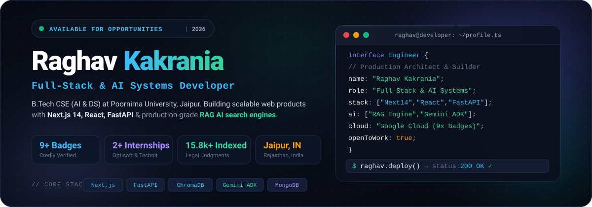
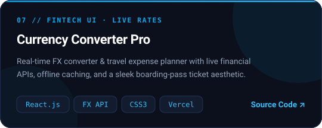
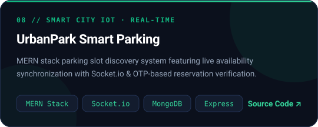

 

 

## 👨‍💻 About Me

Hi! I'm **Raghav Kakrania**, a **Full-Stack & AI Systems Developer** and B.Tech CSE (AI & Data Science) student at Poornima University, Jaipur.

I specialize in architecting high-performance web applications with **Next.js 14, React.js, Node.js, and FastAPI**, integrated with production-ready **AI Agents, RAG search engines, and Google Cloud infrastructure**. With **2 industry internships** and **9+ verified digital credentials** from **Google Cloud, Cisco, and MongoDB**, I bridge enterprise software engineering with real-world AI applications.

 

| Key Metric | Area | Highlights |
| :--- | :--- | :--- |
| 🎖️ **9+ Credly Digital Badges** | Cloud & AI Engineering | Google Cloud Multi-Agent Gemini, Terraform IaC, Compute Engine, MongoDB, Cisco |
| 💼 **2+ Industry Internships** | Full-Stack Software Engineering | Optisoft (InvestorIQ AI CRM) & Technit Space (Droneco Lead & Fee CRM) |
| ⚖️ **15.8k+ Legal Judgments** | Vector RAG & NLP | High-precision statutory retrieval engine indexed in ChromaDB |
| 🚀 **20+ Open-Source Repositories** | Web & Cloud Systems | Production CRM platforms, async microservices, and FinTech calculation engines |

 

---

## 💼 Professional Experience

### 🔹 Software Developer Intern — **Optisoft Business Solutions Pvt. Ltd.**
*On-site · Jaipur, India | May 2026 – Jul 2026*
- Architected and delivered core modules for **InvestorIQ CRM Studio**, an enterprise investor intelligence and deduplication platform built with **Next.js 14, React, MongoDB Atlas, and Tailwind CSS**.
- Built an automated **Gemini Vision OCR ingestion pipeline** to extract structured contact data from complex pitch decks, unstructured PDFs, and financial Excel spreadsheets.
- Engineered a **custom hash-bucket matching algorithm** that detects and merges duplicate institutional records, drastically improving contact data hygiene.
- Implemented multi-tenant workspace architecture with tiered usage subscriptions and granular permission boundaries.

### 🔹 Software Developer Intern — **Technit Space and Aero Works Pvt. Ltd.**
*Remote | May 2026 – Jul 2026*
- Engineered and deployed **Droneco**, an enterprise-grade full-stack MERN CRM platform for coaching institute lead tracking and fee management.
- Designed robust **JWT-based authentication** with strict **Role-Based Access Control (RBAC)** across Student, Staff, and Administrator portals.
- Hardened application security using **rate limiting, input sanitization, Zod schema validation, and bcrypt password hashing**.
- Orchestrated automated backend deployments on **Render** backed by high-availability MongoDB Atlas replica clusters and compound index optimization.

### 🔹 Technical Mentor & Workshop Leader — **Community & Academic Mentorship**
*Poornima University, Jaipur | 2024 – Present*
- Conducted hands-on technical workshops on **MySQL, Relational Database Design, and Schema Normalization** for junior engineering peers.
- Mentored 50+ students in writing optimized SQL queries, understanding indexing strategies, and architecting database layers for web applications.

 

---

## 🚀 Selected & Flagship Work

<table>
<tr>
<td width="50%">
  
  

    <a href="https://investor-intelligence-crm.vercel.app/"><b>🌐 Live Demo</b></a> &nbsp;•&nbsp; 
    <a href="https://github.com/raghav1902/investor-intelligence-crm"><b>💻 GitHub Repo</b></a>
  

</td>
<td width="50%">
  
  

    <a href="https://dhaara-ai-ebon.vercel.app/"><b>🌐 Live Demo</b></a> &nbsp;•&nbsp; 
    <a href="https://github.com/raghav1902/DhaaraAI"><b>💻 GitHub Repo</b></a>
  

</td>
</tr>
<tr>
<td width="50%">
  
  

    <a href="https://droneco-frontend.onrender.com/"><b>🌐 Live Demo</b></a> &nbsp;•&nbsp; 
    <a href="https://github.com/raghav1902"><b>💻 GitHub Profile</b></a>
  

</td>
<td width="50%">
  
  

    <a href="https://github.com/raghav1902/Smartcv-ai-resume-analyzer"><b>💻 GitHub Repo</b></a> &nbsp;•&nbsp; 
    <b>🤖 ATS &amp; Gemini NLP</b>
  

</td>
</tr>
<tr>
<td width="50%">
  
  

    <a href="https://emi-ledger-calculator.vercel.app/"><b>🌐 Live Demo</b></a> &nbsp;•&nbsp; 
    <a href="https://github.com/raghav1902/emi-ledger-calculator"><b>💻 GitHub Repo</b></a>
  

</td>
<td width="50%">
  
  

    <a href="https://github.com/raghav1902/university-library-api"><b>💻 GitHub Repo</b></a> &nbsp;•&nbsp; 
    <b>⚡ High-Concurrency Async API</b>
  

</td>
</tr>
<tr>
<td width="50%">
  
  

    <a href="https://github.com/raghav1902/currency-converter-pro"><b>💻 GitHub Repo</b></a> &nbsp;•&nbsp; 
    <b>💱 Real-Time FX Travel UI</b>
  

</td>
<td width="50%">
  
  

    <a href="https://github.com/raghav1902/Urban-park"><b>💻 GitHub Repo</b></a> &nbsp;•&nbsp; 
    <b>🅿️ Socket.io &amp; MERN Slot System</b>
  

</td>
</tr>
</table>

  <a href="https://github.com/raghav1902?tab=repositories"><b>Explore all 20+ repositories →</b></a>

 

---

## 🛠️ Technical Skills & Architecture Stack

  

 

### 💻 Technologies & Frameworks

 

---

## 🎖️ Verified Credentials & Digital Badges

Industry certifications accredited by **Google Cloud**, **Cisco**, and **MongoDB**, verified on [Credly](https://www.credly.com/users/raghav-kakrania) and [Google Skills Boost](https://www.skills.google/profile/badges?credential_type=skill_badge):

<table>
<tr>
<td align="center" width="33%">
  <a href="https://www.credly.com/users/raghav-kakrania" target="_blank">
     
    <b>Multi-Agent Gemini Workflows</b> 
    ☁️ Google Cloud 
    <small><b>Verify Credential ↗</b></small>
  </a>
</td>
<td align="center" width="33%">
  <a href="https://www.credly.com/users/raghav-kakrania" target="_blank">
     
    <b>First Gemini Enterprise App</b> 
    ☁️ Google Cloud 
    <small><b>Verify Credential ↗</b></small>
  </a>
</td>
<td align="center" width="33%">
  <a href="https://www.credly.com/users/raghav-kakrania" target="_blank">
     
    <b>Engineer AI Agents with ADK</b> 
    ☁️ Google Cloud 
    <small><b>Verify Credential ↗</b></small>
  </a>
</td>
</tr>
<tr>
<td align="center" width="33%">
  <a href="https://www.credly.com/badges/b18154fb-9bd3-47e5-a6f1-554be512947d" target="_blank">
     
    <b>Terraform on Google Cloud</b> 
    ☁️ Google Cloud · Credly 
    <small><b>Verify Credential ↗</b></small>
  </a>
</td>
<td align="center" width="33%">
  <a href="https://www.credly.com/badges/bc961bc7-8878-4089-9f8d-e46e29b9629b" target="_blank">
     
    <b>Load Balancing Compute Engine</b> 
    ☁️ Google Cloud · Credly 
    <small><b>Verify Credential ↗</b></small>
  </a>
</td>
<td align="center" width="33%">
  <a href="https://www.credly.com/badges/21fa74ae-5382-4801-be3e-f04257091148" target="_blank">
     
    <b>App Dev Environment on GCP</b> 
    ☁️ Google Cloud · Credly 
    <small><b>Verify Credential ↗</b></small>
  </a>
</td>
</tr>
<tr>
<td align="center" width="33%">
  <a href="https://www.credly.com/badges/d5f1a7ec-fa72-4a60-af79-6a5e3168e66e" target="_blank">
     
    <b>Develop Google Cloud Network</b> 
    ☁️ Google Cloud · Credly 
    <small><b>Verify Credential ↗</b></small>
  </a>
</td>
<td align="center" width="33%">
  <a href="https://www.credly.com/badges/feb68146-0fca-45a7-92e1-1904419065f9" target="_blank">
     
    <b>MongoDB Basics for Students</b> 
    🍃 MongoDB · Credly 
    <small><b>Verify Credential ↗</b></small>
  </a>
</td>
<td align="center" width="33%">
  <a href="https://www.credly.com/badges/0bce4e3f-c18b-46f7-9938-1a724f4792bd" target="_blank">
     
    <b>Python Essentials 1</b> 
    ⚡ Cisco Networking Academy 
    <small><b>Verify Credential ↗</b></small>
  </a>
</td>
</tr>
</table>

 

---

## 📊 GitHub Analytics & Activity

&nbsp;

  

 

---

## 📬 Let's Work Together

I am actively open to **Software Engineering Roles, AI/Web Developer Opportunities, and Freelance Projects**.

Whether you're looking to build a high-performance web product, integrate custom AI agents or RAG search engines, optimize a database layer, or bring a new idea to life:

- 💼 **LinkedIn**: [linkedin.com/in/raghav-kakrania-087253210](https://www.linkedin.com/in/raghav-kakrania-087253210/)
- 🌐 **Interactive Portfolio**: [raghav1902s-projects.vercel.app](https://portfolio-raghav1902s-projects.vercel.app/)
- 📧 **Direct Email**: [raghavkakrania5@gmail.com](mailto:raghavkakrania5@gmail.com)
- ⚡ **LeetCode**: [leetcode.com/u/raghavkakrania5](https://leetcode.com/u/raghavkakrania5/)
- 🏆 **Unstop**: [unstop.com/u/raghakak47181](https://unstop.com/u/raghakak47181)

 

  ⭐ Designed &amp; engineered by <b>Raghav Kakrania</b> · Always learning, always building.

