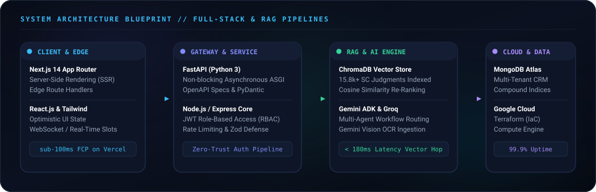
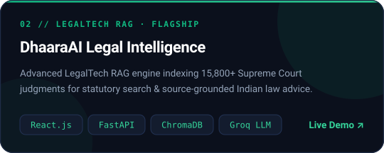
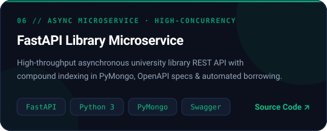
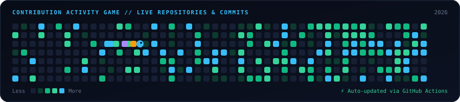

<div align="center">


<br/>

<a href="https://portfolio-raghav1902s-projects.vercel.app/" target="_blank"></a>
<a href="https://www.linkedin.com/in/raghav-kakrania-087253210/" target="_blank"></a>
<a href="https://www.credly.com/users/raghav-kakrania" target="_blank"></a>
<a href="https://leetcode.com/u/raghavkakrania5/" target="_blank"></a>
<a href="mailto:raghavkakrania5@gmail.com"></a>

</div>

<br/>

## 👨‍💻 About Me

Hi! I'm **Raghav Kakrania**, a **Full-Stack & AI Systems Developer** and B.Tech CSE (AI & Data Science) student at Poornima University, Jaipur.

I architect high-performance web products with **Next.js 14, React.js, Node.js, and FastAPI**, integrated with production-ready **AI Agents, RAG search engines, and Google Cloud infrastructure**. With **2 industry internships** and **9+ verified digital credentials** from **Google Cloud, Cisco, and MongoDB**, I bridge scalable web architectures with intelligent AI capabilities.

<br/>

| Key Metric | Engineering Domain | Highlights |
| :--- | :--- | :--- |
| 🎖️ **9+ Digital Badges** | Cloud & AI Engineering | Google Cloud Multi-Agent Gemini, Terraform IaC, Compute Engine, MongoDB, Cisco |
| 💼 **2+ Industry Internships** | Full-Stack Software Engineering | Optisoft (InvestorIQ AI CRM) & Technit Space (Droneco Lead & Fee CRM) |
| ⚖️ **15.8k+ Legal Judgments** | Vector RAG & NLP | High-precision statutory retrieval engine indexed in ChromaDB |
| 🚀 **20+ Open-Source Repos** | Web & Cloud Systems | Production CRM platforms, async microservices, and FinTech calculation engines |

<br/>

---

## 💼 Professional Experience

### 🔹 Software Developer Intern — **Optisoft Business Solutions Pvt. Ltd.**
*On-site · Jaipur, India | May 2026 – Jul 2026*
- Architected and delivered core modules for **InvestorIQ CRM Studio**, an enterprise investor intelligence and deduplication platform built with **Next.js 14, React, MongoDB Atlas, and Tailwind CSS**.
- Built an automated **Gemini Vision OCR ingestion pipeline** to extract structured contact data from complex pitch decks, unstructured PDFs, and financial Excel spreadsheets.
- Engineered a **custom hash-bucket matching algorithm** that detects and merges duplicate institutional records, boosting contact data hygiene.
- Implemented multi-tenant workspace architecture with tiered usage subscriptions and granular permission boundaries.

### 🔹 Software Developer Intern — **Technit Space and Aero Works Pvt. Ltd.**
*Remote | May 2026 – Jul 2026*
- Engineered and deployed **Droneco**, an enterprise-grade full-stack MERN CRM platform for coaching institute lead tracking and fee management.
- Designed robust **JWT-based authentication** with strict **Role-Based Access Control (RBAC)** across Student, Staff, and Administrator portals.
- Hardened application security using **rate limiting, input sanitization, Zod schema validation, and bcrypt password hashing**.
- Orchestrated automated backend deployments on **Render** backed by high-availability MongoDB Atlas replica clusters and compound index optimization.

### 🔹 Technical Mentor & Workshop Leader — **Community & Academic Mentorship**
*Poornima University, Jaipur | 2024 – Present*
- Conducted hands-on technical workshops on **MySQL, Relational Database Design, and Schema Normalization** for junior engineering peers.
- Mentored 50+ students in writing optimized SQL queries, understanding indexing strategies, and architecting database layers for web applications.

<br/>

---

## 🧠 System Architecture Blueprint

*How I architect modern full-stack web products, low-latency microservices, and RAG vector search pipelines:*

<div align="center">
  
</div>

<br/>

---

## 🚀 Selected & Flagship Work

<table>
<tr>
<td width="50%">
  <a href="https://investor-intelligence-crm.vercel.app/" target="_blank">
    
  </a>
  <div align="center">
    <a href="https://investor-intelligence-crm.vercel.app/"><b>🌐 Live Demo</b></a> &nbsp;•&nbsp; 
    <a href="https://github.com/raghav1902/investor-intelligence-crm"><b>💻 GitHub Repo</b></a>
  </div>
</td>
<td width="50%">
  <a href="https://dhaara-ai-ebon.vercel.app/" target="_blank">
    
  </a>
  <div align="center">
    <a href="https://dhaara-ai-ebon.vercel.app/"><b>🌐 Live Demo</b></a> &nbsp;•&nbsp; 
    <a href="https://github.com/raghav1902/DhaaraAI"><b>💻 GitHub Repo</b></a>
  </div>
</td>
</tr>
<tr>
<td width="50%">
  <a href="https://droneco-frontend.onrender.com/" target="_blank">
    
  </a>
  <div align="center">
    <a href="https://droneco-frontend.onrender.com/"><b>🌐 Live Demo</b></a> &nbsp;•&nbsp; 
    <a href="https://github.com/raghav1902"><b>💻 GitHub Profile</b></a>
  </div>
</td>
<td width="50%">
  <a href="https://github.com/raghav1902/Smartcv-ai-resume-analyzer" target="_blank">
    
  </a>
  <div align="center">
    <a href="https://github.com/raghav1902/Smartcv-ai-resume-analyzer"><b>💻 GitHub Repo</b></a> &nbsp;•&nbsp; 
    <b>🤖 ATS &amp; Gemini NLP</b>
  </div>
</td>
</tr>
<tr>
<td width="50%">
  <a href="https://emi-ledger-calculator.vercel.app/" target="_blank">
    
  </a>
  <div align="center">
    <a href="https://emi-ledger-calculator.vercel.app/"><b>🌐 Live Demo</b></a> &nbsp;•&nbsp; 
    <a href="https://github.com/raghav1902/emi-ledger-calculator"><b>💻 GitHub Repo</b></a>
  </div>
</td>
<td width="50%">
  <a href="https://github.com/raghav1902/university-library-api" target="_blank">
    
  </a>
  <div align="center">
    <a href="https://github.com/raghav1902/university-library-api"><b>💻 GitHub Repo</b></a> &nbsp;•&nbsp; 
    <b>⚡ High-Concurrency Async API</b>
  </div>
</td>
</tr>
<tr>
<td width="50%">
  <a href="https://github.com/raghav1902/currency-converter-pro" target="_blank">
    
  </a>
  <div align="center">
    <a href="https://github.com/raghav1902/currency-converter-pro"><b>💻 GitHub Repo</b></a> &nbsp;•&nbsp; 
    <b>💱 Real-Time FX Travel UI</b>
  </div>
</td>
<td width="50%">
  <a href="https://github.com/raghav1902/Urban-park" target="_blank">
    
  </a>
  <div align="center">
    <a href="https://github.com/raghav1902/Urban-park"><b>💻 GitHub Repo</b></a> &nbsp;•&nbsp; 
    <b>🅿️ Socket.io &amp; MERN Slot System</b>
  </div>
</td>
</tr>
</table>

<div align="right">
  <a href="https://github.com/raghav1902?tab=repositories"><b>Explore all 20+ repositories →</b></a>
</div>

<br/>

### 🔬 Engineering Deep-Dives

<details>
<summary><b>🔍 Deep Dive: InvestorIQ CRM Studio — Gemini OCR &amp; Deduplication Engine</b></summary>
<br/>

- **The Challenge**: Venture firms and funds receive pitch decks in unstructured PDFs, scans, and multi-sheet Excel rosters, leading to thousands of duplicate investor contacts and wasted outreach.
- **The Solution**: 
  1. Built an ingestion worker utilizing **Google Gemini Vision OCR** to parse tabular data and text blocks into structured JSON schemas.
  2. Designed a multi-stage **hash-bucket matching engine** combining normalized domain hashing, phonex-fuzzy name matching, and institutional email heuristics to detect and merge duplicate entities.
  3. Deployed on **Next.js 14 App Router** with MongoDB compound indices, achieving sub-second contact deduplication over batches of 500+ records.
</details>

<details>
<summary><b>🔍 Deep Dive: DhaaraAI — Zero-Hallucination LegalTech RAG Architecture</b></summary>
<br/>

- **The Challenge**: LLMs hallucinate case law citations and penal sections, creating fatal errors in legal advisory.
- **The Solution**:
  1. Processed and chunked **15,800+ Supreme Court judgments** and statutory codes (BNS, BNSS, BSA, IPC) with semantic boundaries.
  2. Indexed embeddings via **Sentence Transformers** into a local **ChromaDB vector store** with metadata filtering for judge benches and statutory section mapping.
  3. Grounded response generation using **Groq-accelerated LLMs** with strict source citation verification, ensuring zero ungrounded precedent generation.
</details>

<br/>

---

## 🛠️ Technical Skills & Architecture Stack

<div align="center">
  
</div>

<br/>

<div align="center">

| Layer | Technologies &amp; Tools |
| :--- | :--- |
| **Languages** | `JavaScript (ES6+)` · `TypeScript` · `Python 3` · `SQL (MySQL)` · `C` · `HTML5` · `CSS3` |
| **Frontend** | `Next.js 14` · `React.js` · `Tailwind CSS` · `State Management` · `Responsive Design` · `HTML5 Canvas` |
| **Backend &amp; DB** | `Node.js` · `Express.js` · `FastAPI` · `MongoDB Atlas` · `MySQL` · `ChromaDB Vector DB` · `REST APIs` |
| **AI &amp; RAG** | `RAG Pipelines` · `Gemini Multi-Agent` · `Agent Dev Kit (ADK)` · `Gemini Vision OCR` · `Groq LLM` · `Sentence Transformers` |
| **Cloud &amp; DevOps** | `Google Cloud Platform` · `Terraform (IaC)` · `Compute Engine` · `GKE / Kubernetes` · `Git & GitHub` · `Vercel` · `Render` |

</div>

<br/>

---

## 🛰️ Engineering Tech Radar

| Ring | Focus Area | Technologies &amp; Frameworks |
| :---: | :--- | :--- |
| 🟢 **ADOPT** | Production-Ready Daily Core | `Next.js 14`, `React.js`, `FastAPI`, `ChromaDB`, `MongoDB Atlas`, `Node.js`, `Tailwind CSS`, `RESTful APIs` |
| 🟡 **TRIAL** | Active R&amp;D &amp; Scaled Systems | `Gemini Multi-Agent ADK`, `Gemini Vision OCR`, `Terraform (IaC)`, `Compute Engine`, `Sentence Transformers`, `Groq LLMs` |
| 🔵 **ASSESS** | Architectural Horizon | `LangGraph Multi-Agent Workflows`, `Vector Quantization`, `Docker & GKE Containers`, `vLLM Serving` |

<br/>

---

## 🎖️ Verified Credentials & Digital Badges

Industry certifications accredited by **Google Cloud**, **Cisco**, and **MongoDB**. Direct live verification is available on official credential platforms:

<div align="center">
  <a href="https://www.credly.com/users/raghav-kakrania" target="_blank">
    
  </a>
  &nbsp;
  <a href="https://www.skills.google/profile/badges?credential_type=skill_badge" target="_blank">
    
  </a>
</div>

<br/>

| Badge / Certification | Issuing Organization | Skills &amp; Domain | Verification |
| :--- | :--- | :--- | :---: |
| **Orchestrate Multi-Agent Workflows with Gemini** | ☁️ Google Cloud | Multi-Agent Systems, Gemini Enterprise, Agent Routing | [Verify Credly ↗](https://www.credly.com/users/raghav-kakrania) |
| **Engineer AI Agents with Agent Development Kit (ADK)** | ☁️ Google Cloud | Agent Development Kit, Tool Integration, Python | [Verify Credly ↗](https://www.credly.com/users/raghav-kakrania) |
| **Create Your First Gemini Enterprise Application** | ☁️ Google Cloud | Gemini Enterprise, Vertex AI, Enterprise Chatbots | [Verify Credly ↗](https://www.credly.com/users/raghav-kakrania) |
| **Build Infrastructure with Terraform on Google Cloud** | ☁️ Google Cloud | Infrastructure as Code (IaC), Terraform, Cloud Modules | [Verify Credential ↗](https://www.credly.com/badges/b18154fb-9bd3-47e5-a6f1-554be512947d) |
| **Implement Load Balancing on Compute Engine** | ☁️ Google Cloud | Cloud Load Balancers, Health Checks, GKE Autoscaling | [Verify Credential ↗](https://www.credly.com/badges/bc961bc7-8878-4089-9f8d-e46e29b9629b) |
| **Set Up an App Dev Environment on Google Cloud** | ☁️ Google Cloud | Cloud Functions, Cloud Storage, Pub/Sub Messaging | [Verify Credential ↗](https://www.credly.com/badges/21fa74ae-5382-4801-be3e-f04257091148) |
| **Develop Your Google Cloud Network** | ☁️ Google Cloud | VPC Peering, Cloud Routers, Subnetworks &amp; Firewalls | [Verify Credential ↗](https://www.credly.com/badges/d5f1a7ec-fa72-4a60-af79-6a5e3168e66e) |
| **MongoDB Basics for Students** | 🍃 MongoDB | Document Data Modeling, MongoDB Atlas, Schema Design | [Verify Credential ↗](https://www.credly.com/badges/feb68146-0fca-45a7-92e1-1904419065f9) |
| **Python Essentials 1** | ⚡ Cisco Networking Academy | Core Python Programming, Algorithms, Standard Library | [Verify Credential ↗](https://www.credly.com/badges/0bce4e3f-c18b-46f7-9938-1a724f4792bd) |

<br/>

---

## 📊 Live GitHub Analytics & Activity

<div align="center">

<!-- Real-time dynamic stats cards (auto-refreshes every 30 mins via cache_seconds) -->

&nbsp;


<br/><br/>

<!-- Interactive Automated Contribution Snake Game -->


</div>

<br/>

---

## 💻 Interactive Terminal Card

Try running my CLI card directly inside your terminal:

```bash
npx raghav1902
```

```text
╭──────────────────────────────────────────────────────────────────────────────╮
│                                                                              │
│   Raghav Kakrania                                                            │
│   Full-Stack & AI Systems Developer · Jaipur, Rajasthan, India               │
│                                                                              │
│   Portfolio : https://portfolio-raghav1902s-projects.vercel.app/             │
│   LinkedIn  : https://www.linkedin.com/in/raghav-kakrania-087253210/         │
│   GitHub    : https://github.com/raghav1902                                  │
│   Credly    : https://www.credly.com/users/raghav-kakrania (9x Badges)       │
│                                                                              │
│   Core Stack: Next.js 14 · FastAPI · ChromaDB RAG · Google Cloud AI          │
│   Status    : Available for Full-Stack & AI Systems Engineering              │
│                                                                              │
╰──────────────────────────────────────────────────────────────────────────────╯
```

<br/>

---

## 📬 Let's Work Together

I am actively open to **Software Engineering Roles, AI/Web Developer Opportunities, and Freelance Projects**.

Whether you're looking to build a high-performance web product, integrate custom AI agents or RAG search engines, optimize a database layer, or bring a new idea to life:

- 💼 **LinkedIn**: [linkedin.com/in/raghav-kakrania-087253210](https://www.linkedin.com/in/raghav-kakrania-087253210/)
- 🌐 **Interactive Portfolio**: [raghav1902s-projects.vercel.app](https://portfolio-raghav1902s-projects.vercel.app/)
- 📧 **Direct Email**: [raghavkakrania5@gmail.com](mailto:raghavkakrania5@gmail.com)
- ⚡ **LeetCode**: [leetcode.com/u/raghavkakrania5](https://leetcode.com/u/raghavkakrania5/)
- 🏆 **Unstop**: [unstop.com/u/raghakak47181](https://unstop.com/u/raghakak47181)

<br/>

<div align="center">
  <sub>⭐ Designed &amp; engineered by <b>Raghav Kakrania</b> · Always learning, always building.</sub>
</div>
