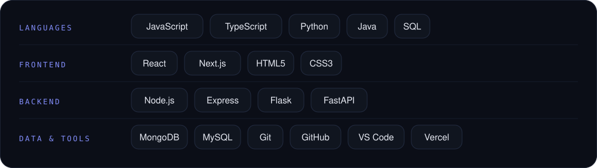
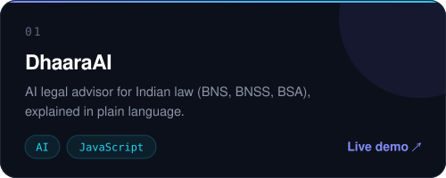
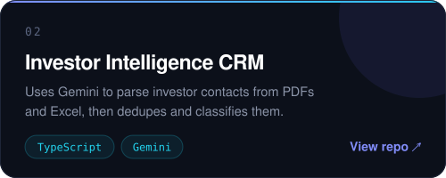
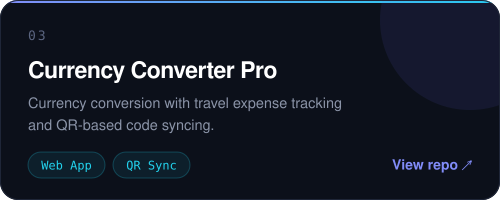
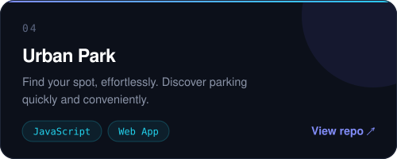
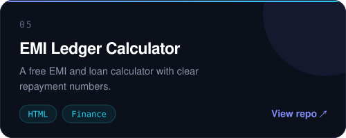

 

 

## About

I'm a B.Tech CSE (AI & Data Science) student at Poornima University, Jaipur. I build full-stack web apps with the MERN stack and add AI where it makes a product genuinely more useful. Most of what I know comes from shipping projects, fixing what breaks and polishing the details.

| Building | Learning | Looking for |
|:--|:--|:--|
| Full-stack apps with AI inside | Making projects reliable and production-ready | Freelance projects and collaborations |

 

## Stack

 

## Selected Work

<table>
<tr>
<td width="50%"></td>
<td width="50%"></td>
</tr>
<tr>
<td width="50%"></td>
<td width="50%"></td>
</tr>
<tr>
<td width="50%"></td>
<td width="50%" align="center"> <b>DhaaraAI source:</b> <a href="https://github.com/raghav1902/DhaaraAI">github.com/raghav1902/DhaaraAI</a>  <a href="https://github.com/raghav1902?tab=repositories">All repositories →</a></td>
</tr>
</table>

 

## Activity

 

## Let's work together

I take on freelance projects: responsive websites, React frontends, APIs and databases, AI features and small business tools. If you have an idea, message me on [LinkedIn](https://www.linkedin.com/in/raghav-kakrania-087253210/).

 
Always learning, always building.

